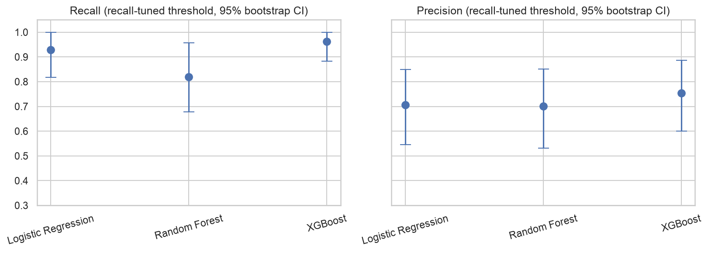
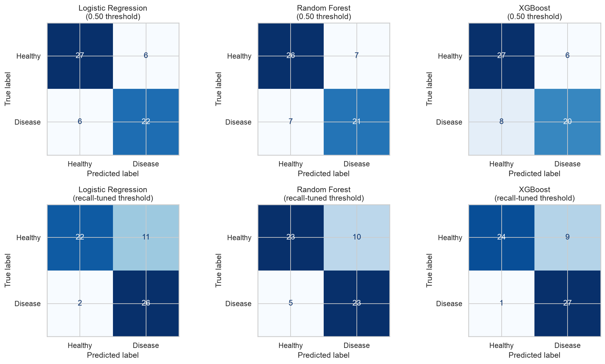
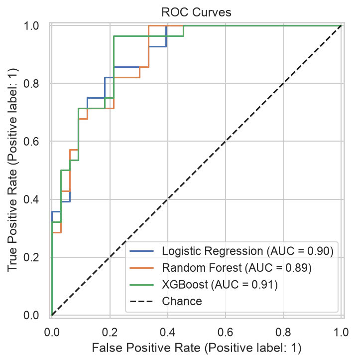
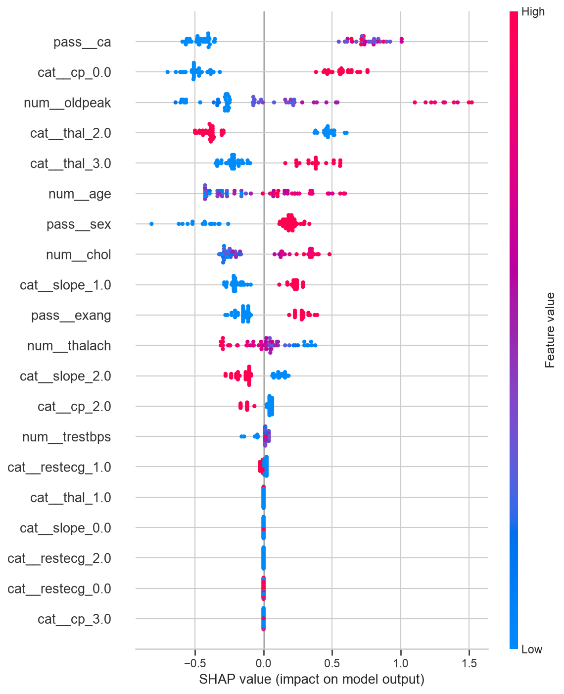

# Heart Disease Prediction System

A leak-free machine learning pipeline that predicts heart disease from 13 clinical features, with a **recall-first** evaluation: missing a sick patient is treated as far worse than a false alarm. It compares logistic regression, random forest, and XGBoost, quantifies uncertainty with bootstrap confidence intervals, and ships with a Streamlit app for entering a patient and getting a risk estimate.

> **Educational project, not a medical device.** Do not use it for health decisions.

**Stack:** Python, pandas, SQL (SQLite), scikit-learn, XGBoost, SHAP, Streamlit

---

## Key results

Trained on 241 patients, tested on a held-out 61 (stratified split, `random_state=42`).

**5-fold cross-validation on the training set** (default hyperparameters):

| Model | Recall | Precision | F1 | ROC-AUC | Accuracy |
|---|---|---|---|---|---|
| Logistic Regression (baseline) | 0.809 | 0.860 | 0.832 | 0.926 | 0.851 |
| Random Forest | 0.782 | 0.846 | 0.807 | 0.907 | 0.830 |
| XGBoost | 0.764 | 0.775 | 0.765 | 0.887 | 0.784 |

**Held-out test set at the recall-tuned threshold** (chosen to catch about 90% of sick patients in training data). Brackets are 95% bootstrap confidence intervals from 2,000 resamples of the test set.

| Model | Recall | Precision | ROC-AUC | Missed sick (FN) | False alarms (FP) |
|---|---|---|---|---|---|
| Logistic Regression | 0.929 [0.818, 1.000] | 0.703 [0.545, 0.848] | 0.896 [0.810, 0.963] | 2 | 11 |
| Random Forest | 0.821 [0.677, 0.957] | 0.697 [0.531, 0.852] | 0.892 [0.804, 0.959] | 5 | 10 |
| XGBoost | 0.964 [0.882, 1.000] | 0.750 [0.600, 0.886] | 0.908 [0.826, 0.970] | 1 | 9 |

Lowering the threshold from the default 0.50 cut missed sick patients from 6, 7, and 8 (logistic regression, random forest, XGBoost) to 2, 5, and 1, at the cost of a few more false alarms.

### How to read these numbers

- **The models are statistically hard to tell apart.** The test set has 61 patients (28 sick), so one patient moves recall by about 3.5 points, and the confidence intervals overlap heavily.
- **Logistic regression is the strongest and simplest model in cross-validation** (best AUC at defaults and after tuning). On about 300 rows it is competitive with the tree models, which is why it is the model served in the app.
- **Reported performance is optimistic for real-world use.** All data comes from one dataset, with no external validation.




---

## Approach

1. **Data cleaning.** The CSV had 606 rows, but every row appeared twice (302 unique patients). Duplicates were dropped *before* splitting so copies cannot leak between train and test. `thal = 0` and `ca = 4` are invalid codes that stand in for missing values, so they were converted to `NaN` and imputed.
2. **Target check.** In this version of the dataset, raw `target = 0` marks disease (verified from feature means and the correlation heatmap), so the label is recoded to `1 = disease`.
3. **SQL exploration.** The cleaned data is loaded into SQLite and queried for class balance, vitals by class, and disease rate by chest pain type and age group.
4. **Leak-free preprocessing.** Imputation, scaling (numeric features), and one-hot encoding (`cp`, `restecg`, `slope`, `thal`) live inside a scikit-learn `Pipeline`, so they are refit within each cross-validation fold.
5. **Model comparison.** Logistic regression (baseline), random forest, and XGBoost, each tuned with 5-fold stratified `GridSearchCV` on ROC-AUC.
6. **Recall-focused threshold.** The decision threshold is the highest one that still catches at least 90% of sick patients, selected on out-of-fold *training* predictions, never on the test set.
7. **Uncertainty.** Bootstrap resampling of the test set gives 95% intervals for recall, precision, F1, and ROC-AUC.
8. **Explainability.** Logistic regression coefficients, tree feature importances, and SHAP values for XGBoost.




---

## Run it

```bash
python3 -m venv .venv
source .venv/bin/activate
pip install -r requirements.txt

python main.py          # runs the pipeline, saves figures/, results/, models/, tableau/
streamlit run app.py    # launches the risk estimator
```

On macOS, XGBoost needs the OpenMP runtime: `brew install libomp`. If tuning gets killed on a low-memory machine, set `N_JOBS = 1` in `main.py`.

## Streamlit app

Enter a patient's age, sex, blood pressure, cholesterol, heart rate, ECG and exercise results, and the app returns an estimated disease probability and whether it exceeds the recall-tuned screening cutoff. `ca` and `thal` can be set to *Unknown*, and the pipeline imputes them. Category codes (`cp`, `restecg`, `slope`, `thal`) are shown as the dataset's own numeric codes.

## Project structure

```
main.py                 Full pipeline: cleaning, SQL, models, bootstrap, plots, exports
app.py                  Streamlit risk estimator
heart_disease_data.csv  Source data (Cleveland heart disease)
requirements.txt
models/                 Saved model, threshold, and metrics used by the app
figures/                Plots used in this README
results/                CV, test, and bootstrap tables (CSV)
tableau/                Tidy CSVs for building dashboards
```

## Limitations

- Small dataset (302 unique patients) and a single 61-patient test split, so metrics are noisy.
- No external validation. A natural next step is training on the Cleveland data and testing on the other UCI sites (Hungarian, Long Beach VA, Switzerland).
- The categorical features use the dataset's numeric codes without clinical labels, because this version recodes some categories.
- The 90% recall target is a design choice, not a clinically validated one.